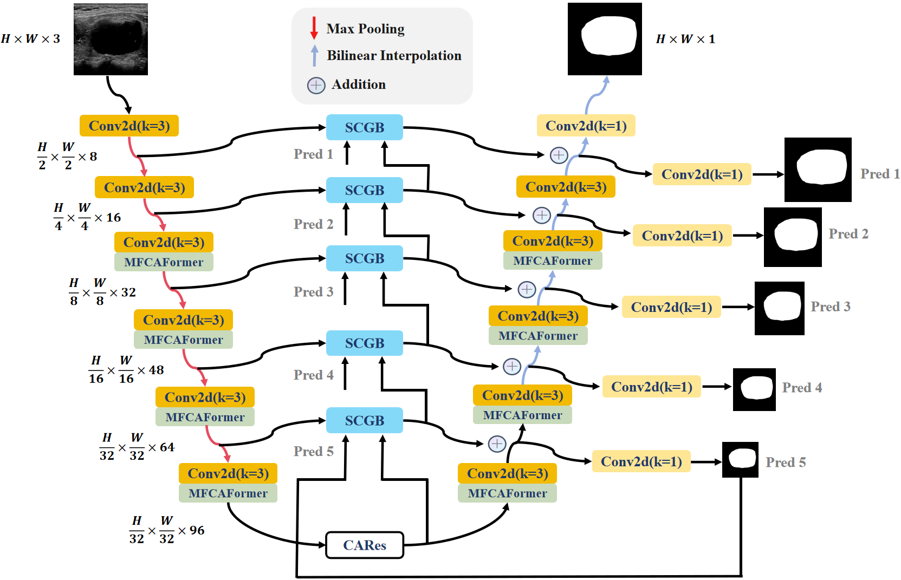

# MCS-Net





## Main Environments

- python 3.9
- pytorch 2.1.0
- torchvision 0.16.0
- For generating GradCAM results, please follow the code on this [repository](https://github.com/jacobgil/pytorch-grad-cam)


## Requirements

Install from the `requirements.txt` using:

```
pip install -r requirements.txt
```


## Prepare the dataset.

- The DDTI datasets, can be found here ([link]())
- The TN3K datasets, can be found here ([link]())
- The GlaS  datasets, can be found here ([link]())
- The Chest Xray datasets, can be found here ([link]())
- The CVC-ClinicDB datasets, can be found here ([link]())
- The Kvasir-SEG datasets, can be found ([link]())
- The ISIC2017 datasets, can be found here ([link]())
- The Synapse datasets, can be found ([link]())
- The ACDC datasets, can be found ([link]())


## Reference
- [UNet](https://github.com/ZJUGiveLab/UNet-Version)
- [TransUNet](https://github.com/Beckschen/TransUNet)
- [UCTransNet](https://github.com/McGregorWwww/UCTransNet)
- [ACC_UNet](https://github.com/qubvel/segmentation_models.pytorch)


